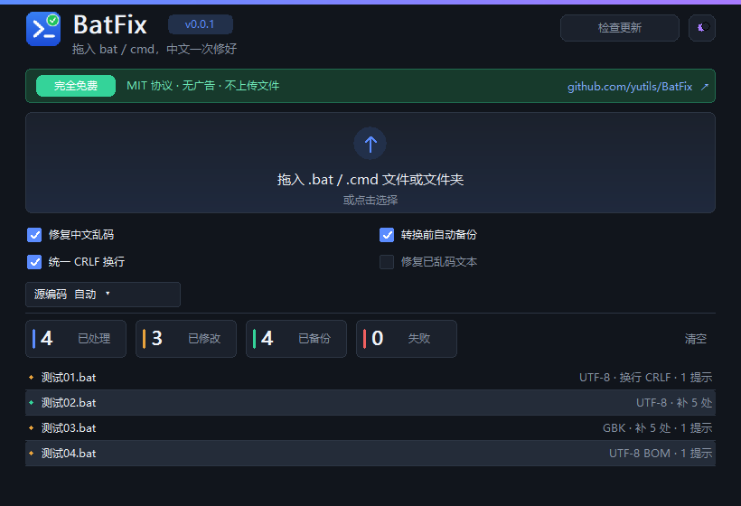
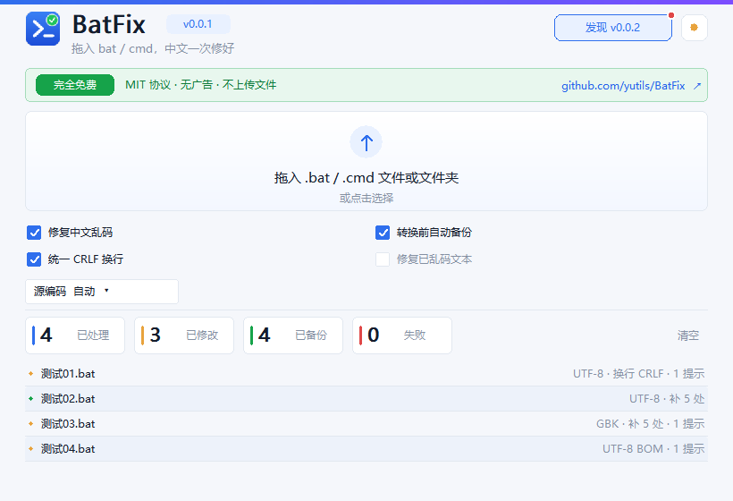

# BatFix

> 拖一下，让任何 `.bat` / `.cmd` 在中文 Windows 上正常显示中文、不再乱码。


**当前版本 `v0.0.1`** · 仓库：[yutils/BatFix](https://github.com/yutils/BatFix) · 协议：[MIT](LICENSE) · 单文件、零第三方 DLL


---

## 它解决什么

`cmd.exe` 读取批处理文件有两个坑，只解决其中一个仍然会乱码：

1. **代码页不匹配**：cmd 按当前控制台代码页解析文件，中文 Windows 默认是 `936 (GBK)`。UTF-8 编码的中文会被按 GBK 解读 → 乱码。在开头加 `chcp 65001 >nul` 可切换，但文件必须是 **UTF-8 无 BOM**——带 BOM 时那三个字节会被当作第一条命令的一部分，报出以「锘」开头的乱码错误。
2. **行尾多字节字符 bug**（更少人知道）：cmd 按字节块扫描行尾，当一行以多字节 UTF-8 字符（汉字、全角标点、emoji）**紧贴 CRLF** 结束时，末尾字节会和 `\r` 被误判成一个 GBK 双字节字符，行边界错位 → 乱码甚至命令报错。在这类行尾补一个半角空格即可规避。

但「给每行都加空格」会改坏脚本：`set var=值` 的值会多一个尾随空格、`echo x>结果` 的文件名会变、`^` 续行会失效。BatFix 把这个规避做成了**语义安全**的自动转换。

## 界面

- 自绘卡片式布局，浅色 / 深色主题（右上角切换），文字极少
- 顶部品牌渐变条 + 真实应用图标 + 版本徽章；底部 4 个统计卡片（已处理 / 已修改 / 已备份 / 失败）
- **首页信息条明确标注「完全免费」与 MIT 协议**，并展示可点击的开源地址 `github.com/yutils/BatFix`（点击用默认浏览器打开）
- 右上角「检查更新」：启动后后台查询 GitHub Releases，发现新版本才亮**小红点**；联网失败完全静默
- 渐变拖放区，也可点击选择文件；支持拖入整个文件夹（递归）
- 4 个明确的复选框 + 1 个「源编码」下拉
- 结果列表一行一条摘要，**点击某行**查看该文件完整报告
- 复选框采用「按下与松开必须落在同一控件」的防误触校验，热区仅限方框+文字



## 快速开始

### 获得可执行文件

仓库**不提交 `dist/`**，所以克隆下来先二选一：

1. 从 GitHub **Releases** 下载 `BatFix_v0.0.1.exe`（x64）/ `BatFix_v0.0.1_x86.exe`（x86），零依赖，下载即用
2. 双击根目录的 **`一键编译.bat`** 自行编译，同名产物生成在本地 `dist/`

拿到 exe 后双击它，把 `.bat` / `.cmd` 文件或文件夹拖进窗口（或直接拖到 exe 图标上）即自动转换。

- 每次原地转换都会**先备份**原文件为 `xxx.bat.bak`、`xxx.bat.bak.1`……，即使文件已经合规也会备份
- 同一个文件反复转换不会重复写入，结果是幂等的
- 程序**只允许单例**：第二次启动会把文件转发给已有窗口并激活它，不会开第二个窗口

### 命令行（供自动化 / 批处理，可选）

```bat
BatFix_v0.0.1.exe --cli [--out <目录>] [--report <文件.tsv>] [--no-backup] [--mojibake] [--cp 936] <文件/文件夹...>
BatFix_v0.0.1.exe --cli --no-chcp --no-tail --no-backup <文件>
```

| 参数 | 作用 |
|---|---|
| `--out <目录>` | 转换结果写到指定目录，不改动原文件 |
| `--report <tsv>` | 输出 UTF-8 报告（编码、BOM、换行、chcp、补空格/改写行数、备份名、结果） |
| `--no-backup` | 不生成备份 |
| `--mojibake` | 尝试还原「UTF-8 被按 GBK 误读」型乱码（默认关闭） |
| `--cp <代码页>` | 手动指定 ANSI 源编码：936 / 950 / 932 / 1252 / 65001 |
| `--no-chcp` / `--no-tail` / `--no-newline` | 分别关闭 chcp 管理 / 行尾修复 / 换行统一 |

开发者选项：`--shot <bmp> [--dark]` 离屏渲染真实界面预览；`--smoke` 仅自检窗口创建后立即退出；`--no-update-check` 本次启动不联网。更新检查相关的诊断参数见[检查更新与发布规范](#检查更新与发布规范)。

> CLI 同样遵守单例：GUI 窗口还开着时，命令行调用直接返回退出码 `2`。写自动化脚本前请先关闭窗口。

## 版本号与图标

**版本号的唯一来源是根目录的 `VERSION`**（当前 `0.0.1`）。要发新版本，只改这一个文件，再双击 `一键编译.bat` 即可，其它地方全部自动跟随：

| 位置 | 结果 |
|---|---|
| 编译产物 | `dist/BatFix_v0.0.1.exe`（x64）、`dist/BatFix_v0.0.1_x86.exe`（x86） |
| exe 文件属性 | `FileVersion` / `ProductVersion` = `0.0.1`，含公司、描述、版权（由 `src/version.rc` 写入） |
| 窗口 / 界面 | 标题栏 `BatFix v0.0.1`，副标题末尾 `· v0.0.1` |
| CLI | 报告首行 `BatFix v0.0.1  files=N` |
| 测试脚本 | 从 `VERSION` 自动拼出 exe 路径，升级版本无需改测试代码 |

`build.ps1` 会据此生成 `dist/version.h`，C++ 与 `rc.exe` 共用同一份宏定义，避免版本号散落在多处。

**图标**：`src/BatFix.ico` 是蓝色圆角磁贴 + 白色 `>_` 终端提示符 + 绿色完成徽章，含 16/24/32/48/64/128/256 共 7 种尺寸（PNG-in-ICO），由纯 Python 标准库脚本 `tools/make_icon.py` 生成，编译后作为 exe 资源嵌入。想换设计就改脚本再跑一次：

```bash
python tools/make_icon.py
```

它会同时更新 `src/BatFix.ico` 和 256px 预览 `doc/BatFix_图标.png`。

## 检查更新与发布规范

启动后会在**后台线程**向 `https://api.github.com/repos/yutils/BatFix/releases/latest` 发一个 HTTPS GET，不阻塞窗口。右上角「检查更新」按钮：

| 结果 | 表现 |
|---|---|
| 有更新的 Release | 按钮变成「发现 v0.0.2」，右上角出现**小红点**；点击弹窗对比当前 / 最新版本，确认后打开该 Release 下载页 |
| 已是最新 | 按钮显示「已是最新」，点击提示当前版本 |
| **无网络 / 超时 / 404 / 限流 / JSON 异常** | **完全静默**：不弹窗、不报错、不显示红点，按钮保持「检查更新」 |



**发布命名约定**（按你定的规则实现）：

| 项 | 格式 | 示例 |
|---|---|---|
| Git tag | 纯版本号 | `0.0.1` |
| Release 标题 | `v` + 版本号 | `v0.0.1` |
| `VERSION` 文件 | 纯版本号 | `0.0.1` |
| 编译产物 | `BatFix_v<版本>.exe` | `BatFix_v0.0.1.exe` |

工具同时读取 API 的 `tag_name` 与 `name`，两者都能解析出版本号；若不一致取较大的那个，避免 tag 写错导致漏提示。版本按数字段逐段比较（`v0.0.2 > v0.0.1`、`v0.1 > v0.0.9`），数字段相同时带 `-beta` 后缀的预发布不算比正式版新。下载页优先用 API 返回的 `html_url`，并校验必须是本仓库的 `https://github.com/` 地址，否则回退到 Releases 首页。

**目前仓库还没有 Release**，API 返回 404，所以现在启动不会有任何提示 —— 这是预期行为。等你上传第一个 Release 后，旧版本启动就会自动亮红点。

发布新版本的顺序：

1. 改根目录 `VERSION`（如 `0.0.2`），双击 `一键编译.bat`
2. 在 GitHub 建 tag `0.0.2`，Release 标题填 `v0.0.2`，上传 `BatFix_v0.0.2.exe` / `BatFix_v0.0.2_x86.exe`
3. 勾选 **Set as the latest release**（`/releases/latest` 只返回被标记为 Latest 的那个）
4. 同步更新 README 里的版本号与文件名

> 隐私：除这一个 GET 外没有任何网络行为，不收集设备信息、不上传脚本内容。离线 / 内网环境可用 `--no-update-check` 启动以完全禁用检查。`winhttp.dll` 是运行时动态加载的系统组件，exe 静态依赖仍是 5 个系统 DLL。

开发者诊断参数（仅供自测）：

| 参数 | 作用 |
|---|---|
| `--no-update-check` | 本次启动不检查更新 |
| `--selftest-update` | 离线跑版本比较与 JSON 解析断言，输出 `UPDATE_SELFTEST pass=N fail=0` |
| `--update-sync` | 同步执行一次真实网络检查，打印结果后退出，不建窗口 |
| `--update-file <json>` | 用本地 JSON 冒充 API 响应，走完整「解析 → 判定 → 渲染」链路 |
| `--update-demo` | 配合 `--shot` 渲染带红点的界面预览 |

## 转换规则

| 项目 | 处理 |
|---|---|
| 编码识别 | UTF-8 无 BOM / UTF-8 BOM / 堆叠 BOM / UTF-16 LE·BE / UTF-32 LE·BE / 无 BOM 的 UTF-16 推断 / ANSI(系统 ACP，若为 65001 则回退 936) / 纯 ASCII |
| 输出 | 统一 **UTF-8 无 BOM**，移除开头的全部 BOM |
| 换行 | LF / CR / 混合 → **CRLF**，并补齐文件末尾换行 |
| chcp | 清理所有独立 chcp 行（含无参数 `chcp`，它会多打印一行 `Active code page`），保证恰好一条 `chcp 65001` |
| 备份 | 原地模式先快照原文件，再决定是否改写；`--out` / `--no-backup` / 二进制跳过时不备份 |
| 幂等 | 二次转换字节完全不变，不重复插入 chcp、不重复补空格 |
| 其它 | 只读文件、`.cmd`、中文长路径、递归文件夹、超长行警告、非 BMP 字符字体提示 |

### 行尾修复为什么不会改坏 `if` / `for`

**只处理「行尾最后一个字符是非 ASCII」的行**。以 ASCII 结尾的行——`^` 续行、`(` / `)` 括号块、`set "x=y"`、引号、ASCII 结尾的重定向目标——一个字节都不动。

对确实需要修复的行，按语义分类：

| 行类型 | 处理 | 例子 |
|---|---|---|
| 注释 / 标签 / echo 输出 | 行尾补一个半角空格 | `echo 中文 ` |
| 无引号 `set` 赋值 | 改写成引号形式（末尾变 ASCII 引号，值不变） | `set x=中文` → `set "x=中文"` |
| `set /p` 提示 | 同上 | `set /p z=请输入` → `set /p "z=请输入"` |
| 中文重定向目标 | 目标加引号 | `echo x>结果` → `echo x>"结果"` |
| 路径类命令 | 最后一个参数加引号 | `cd 中文目录` → `cd "中文目录"` |
| 复合 chcp 命令 | 只替换代码页数字，不吞掉 `&` 后的命令 | `chcp 936&echo 中文` → `chcp 65001&echo 中文` |

chcp 采用用户实证有效的布局：有 `@echo off` 时保持它在第 1 行、`chcp 65001 >nul` 放第 2 行；没有时首行用 `@chcp 65001 >nul`（`@` 抑制回显）。`for /f ... ('chcp')` 这类命令字符串不会被误改。

## 自己编译

### 前置条件

- Windows 10 / 11
- **Visual Studio 2017 / 2019 / 2022** 任意 SKU（Build Tools、Community、Professional、Enterprise 均可），安装时勾选 **「使用 C++ 的桌面开发」** 并确保包含 **MSVC 工具集** 与 **Windows 10/11 SDK**
- 不需要 CMake、不需要 Ninja、不需要第三方库、不需要打开 Developer PowerShell

> 不想编译？请从 Releases 下载预编译版本。`dist/` 只是本地编译输出目录，已加入 `.gitignore`，不会进仓库。

### 双击一键编译

双击项目根目录的 **`一键编译.bat`**。它会：

1. 读取 `VERSION`，生成 `dist/version.h`
2. 用 `vswhere.exe` 探测所有 VS 安装（找不到时扫描常见目录兜底），自动选择最新的 MSVC 工具集与 Windows SDK
3. 用 `rc.exe` 编译 `src/version.rc`，把图标与 VERSIONINFO 编进 exe
4. 手工设置 `INCLUDE` / `LIB` / `Path`，依次编译 **x64 + x86**
5. 把带版本号的产物写入本地 `dist/`（该目录不进仓库），并打印每一步结果

找不到工具链时会给出中文指引和下载链接，不会改动任何文件。脚本用 `-ExecutionPolicy Bypass` 调用 PowerShell，因此不受本机执行策略限制。

> 为什么 `一键编译.bat` 是纯 ASCII、且没有 `chcp 65001`：PowerShell 5.1 会缓存启动时的控制台输出编码，若 bat 先把代码页切到 65001，PowerShell 的中文输出反而会按旧编码写出、被控制台错误解码成乱码。所以入口只负责启动，中文提示统一由 `build.ps1` 在显式设置 UTF-8 输出后打印。这个 bat 本身也符合 BatFix 的规范（用本工具转换它会得到「已符合规范」）。

### 命令行编译

```powershell
powershell -NoProfile -ExecutionPolicy Bypass -File build.ps1 -Arch both
powershell -NoProfile -ExecutionPolicy Bypass -File build.ps1 -Arch x64
```

编译参数：`/std:c++17 /MT /O2 /EHsc /utf-8`，`/MT` 静态链接 CRT，`/SUBSYSTEM:WINDOWS`，只链接 `kernel32 / user32 / gdi32 / comdlg32 / shell32`（全是系统 DLL），并用 `mt.exe` 嵌入 DPI 与视觉样式清单。产物不依赖 VCRUNTIME 或任何第三方 DLL。

## 测试

`tests/` 下有完整的字节级回归 + 真实运行验证（需要 Python 3）：

```bat
cd tests
python make_cases.py          :: 生成 119 个覆盖各种编码/换行/语法的用例
python verify.py              :: 字节级回归，含二次转换幂等
python check_user_cases.py    :: 用户实际报告有问题的 4 个文件
python test_backup_matrix.py  :: 备份矩阵（10 文件 + 连拖 3 次 + 3 种 CLI 模式）
python test_backup_toggle.py  :: 复选框开/关 + 防误触
python test_singleton.py      :: 单例与参数转发
python test_update.py         :: 更新检查（27 项逻辑断言 + 真实网络 + 10 个 JSON 场景 + 静默验证）
..\dist\BatFix_v0.0.1.exe --smoke    :: GUI 窗口创建自检
```

真实执行转换后的脚本（用 PowerShell 原生语法，不显式调用 `cmd.exe`）：

```powershell
powershell -NoProfile -ExecutionPolicy Bypass -File tests\run_display.ps1
python tests\check_runtime.py
```

当前结果：119 用例、117 个输出二次转换 100% 幂等，8 个显示用例 + 4 个用户文件真实运行中文完整、无报错、无多余输出；更新检查专项 40+ 项断言全绿（含启动 0.04 s 不被网络阻塞、失败不弹任何对话框、10 种 Release JSON 场景的红点像素校验）。

## 目录结构

```
BatFix/
├── VERSION                 # 版本号唯一来源（0.0.1）
├── 一键编译.bat            # 双击入口
├── build.ps1               # 自适应编译脚本
├── README.md / LICENSE / .gitignore
├── src/
│   ├── BatFix.cpp          # 编码识别、转换引擎、CLI
│   ├── Ui.inc              # 自绘界面（由 BatFix.cpp include）
│   ├── Update.inc          # 异步 Release 检查（运行时加载 winhttp.dll）
│   ├── app.manifest        # DPI / 视觉样式 / asInvoker
│   ├── version.rc          # 图标 + VERSIONINFO 资源
│   └── BatFix.ico          # 应用图标（7 种尺寸）
├── tools/
│   └── make_icon.py        # 纯标准库生成 .ico 与图标预览
├── doc/
│   ├── BatFix_图标.png           # 图标 256px 预览
│   ├── BatFix_界面预览.png       # 界面截图（浅色）
│   ├── BatFix_界面预览_深色.png  # 界面截图（深色）
│   └── BatFix_界面预览_更新提示.png  # 发现新版本时的红点
├── dist/                   # 本地编译输出，已忽略，不进仓库
│   ├── BatFix_v0.0.1.exe          # x64
│   └── BatFix_v0.0.1_x86.exe      # x86
└── tests/                  # 用例生成器与回归脚本
```

## 已知限制

- **emoji 方框不是乱码**：UTF-8 编码已正确，传统 `conhost` 字体不支持非 BMP 字符。换 Windows Terminal 或支持 emoji 的字体即可。
- **ANSI 源文件里丢失的字符无法恢复**：GBK 表示不了的 emoji 等在保存那一刻就被替换成 `?` 了。
- **mojibake 修复是启发式的**，只在「重新按 GBK 编码后恰好是合法 UTF-8」的数学验证通过时才改写，默认关闭。
- `chcp 65001` 会改变控制台代码页；若脚本用它读写外部 GBK 文件，工具会给出警告，需人工复核。
- 每次原地转换都生成递增备份，反复拖会累积 `.bak.N`；不想要就取消勾选「转换前自动备份」。
- **检查更新依赖 GitHub API**：未认证请求限流 60 次/小时，且 `/releases/latest` 只返回被标记为 Latest 的 Release；任何失败都静默，不影响转换功能。离线环境可用 `--no-update-check`。

## 参考与致谢

- [wu-jianwen/encoding-doctor](https://github.com/wu-jianwen/encoding-doctor) — mojibake 数学验证还原思路（它主张 `.bat` 转 GBK，路线相反，备份/还原机制值得借鉴）
- [qrqr2100/windows-encoding-preflight-lint](https://github.com/qrqr2100/windows-encoding-preflight-lint) — 规则表驱动的编码体检
- [TianYunCode/EncodingConverter](https://github.com/TianYunCode/EncodingConverter) — Qt6 批量编码转换
- 批处理之家关于「行尾汉字导致换行符误读」的讨论、ServerFault 关于 cmd 按 512 字节块解析的分析、Stack Overflow 上 mklement0 关于 UTF-8 批处理的回答
- 论坛工具 BatchConvert v1.1（纯 C++，功能相近但不处理行尾多字节 bug）

## License

[MIT](LICENSE) © 2026 yutils
