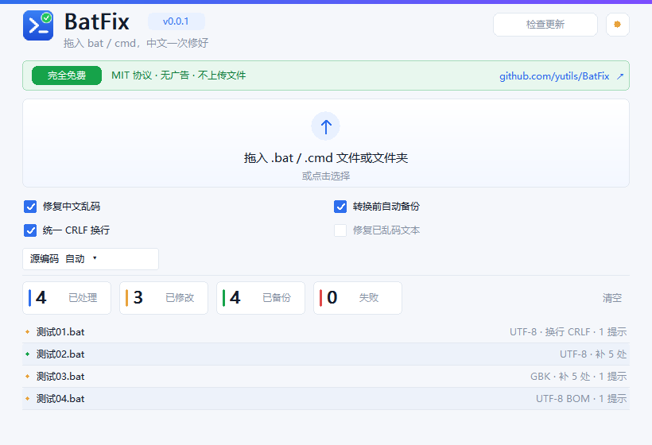
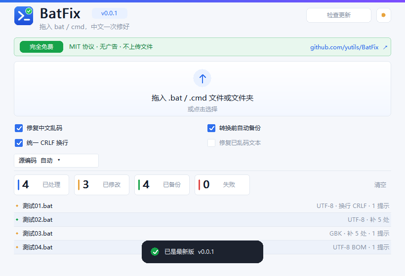

# BatFix

> 拖一下，让任何 `.bat` / `.cmd` 在中文 Windows 上正常显示中文、不再乱码。


**v0.0.1** · [yutils/BatFix](https://github.com/yutils/BatFix) · [MIT](LICENSE) · 单文件、零第三方 DLL



---

## 为什么需要它

`cmd.exe` 有两个坑，只修一个仍会乱码：

1. **代码页**：中文 Windows 默认按 GBK 解析 UTF-8 文件 → 乱码；`chcp 65001 >nul` 可切换，但文件必须是 **UTF-8 无 BOM**（带 BOM 会报「锘…」开头的错误）。
2. **行尾多字节字符**：一行以汉字 / 全角标点 / emoji 紧贴 CRLF 结束时，末尾字节会和 `\r` 被误判成一个 GBK 双字节字符 → 行边界错位。

无脑给每行补空格会改坏脚本：`set var=值` 的值多一个尾随空格、`echo x>结果` 的文件名会变、`^` 续行失效。BatFix **只处理行尾是非 ASCII 的行**，并对少数敏感行改写成等价的安全形式。

## 转换规则

| 项目 | 处理 |
|---|---|
| 编码 | 识别 UTF-8 无 BOM / BOM（含堆叠）、UTF-16 LE·BE、UTF-32 LE·BE、无 BOM 的 UTF-16、ANSI（系统 ACP，为 65001 时回退 936）、纯 ASCII → 统一输出 **UTF-8 无 BOM** |
| 换行 | LF / CR / 混合 → **CRLF**，并补齐文件末尾换行 |
| chcp | 清理所有独立 chcp 行（含无参数 `chcp`，它会多打印一行 `Active code page`），保证恰好一条 `chcp 65001`；有 `@echo off` 时置于第 2 行，否则首行用 `@chcp 65001 >nul`。不碰 `for /f ('chcp')` 与复合命令 |
| 行尾 | 注释 / echo 补一个半角空格；`set x=中文` → `set "x=中文"`；`echo x>结果` → `echo x>"结果"`；`cd 中文目录` → `cd "中文目录"`。`^` 续行、`(` `)` 括号块、`set "x=y"` 一律不动 |
| 备份 | 原地转换**每次先备份** `xxx.bat.bak` / `.bak.1`…，文件已合规也备份 |
| 其它 | 完全幂等（二次转换字节不变）、只读文件、`.cmd`、中文长路径、递归文件夹、超长行警告、可选修复「UTF-8 被按 GBK 误读」型乱码 |

## 使用

仓库不提交 `dist/`，所以从 **Releases** 下载 `BatFix_v0.0.1.exe`（x64）/ `BatFix_v0.0.1_x86.exe`（x86），或双击根目录 **`一键编译.bat`** 自行编译。

双击 exe，把 `.bat` / `.cmd` 文件或整个文件夹拖进窗口（也可直接拖到 exe 图标上）即自动转换。程序**只允许单例**：第二次启动会把文件转发给已有窗口并激活，不会开第二个窗口。

界面是纯自绘卡片布局：浅色 / 深色主题、首页「完全免费」标识与可点击的开源地址、4 个复选框 + 源编码下拉、4 个统计卡片，点击结果行看详情。复选框带「按下与松开必须落在同一控件」的防误触校验。



更多截图：[深色主题](doc/BatFix_界面预览_深色.png) · [发现新版本时的红点](doc/BatFix_界面预览_更新提示.png)

### 命令行（可选）

```bat
BatFix_v0.0.1.exe --cli [--out 目录] [--report 文件.tsv] [--no-backup] [--cp 936] <文件/文件夹...>
```

`--out` 另存且不改原文件 · `--report` 输出 UTF-8 报告 · `--mojibake` 修复已乱码文本 · `--cp` 指定 ANSI 源编码（936 / 950 / 932 / 1252 / 65001）· `--no-chcp` / `--no-tail` / `--no-newline` 分项关闭 · `--no-backup` 不备份。

> CLI 同样受单例约束：GUI 开着时命令行直接返回退出码 `2`。开发者选项（`--shot`、`--smoke`、`--update-sync`、`--selftest-update`、`--update-file`、`--update-demo`、`--toast-demo`、`--no-update-check`，以及测试用环境变量 `BATFIX_TOAST_TRACE`）见源码与 `tests/`。

## 检查更新

启动后在**后台**检查 GitHub Releases，不阻塞窗口；**只有用户主动点击**才可能提示。

| 结果 | 表现 |
|---|---|
| 有新版本 | 按钮变「发现 v0.0.2」+ 右上角**小红点**；点击对比当前 / 最新版本，确认后跳转下载页 |
| 已是最新版 | 点击后底部弹 **toast「已是最新版 v0.0.1」**，约 2.4 秒淡出，不抢焦点、不用确认 |
| 无网 / 超时 / 404 / 限流 / 解析失败 | **完全静默**：不弹窗、不报错、不显示红点 |

检查优先走 REST API `api.github.com/repos/yutils/BatFix/releases/latest`；失败时（常见于未认证 60 次/小时限流返回 403）自动改走网页 `/releases/latest` 的 302 `Location`，从中读出 `/releases/tag/<tag>`。两条都失败才静默。只发 GET，不收集设备信息、不上传脚本内容；离线 / 内网可用 `--no-update-check` 完全禁用。

**发布约定**：tag `0.0.2`、Release 标题 `v0.0.2`、根目录 `VERSION` 写 `0.0.2`、产物 `BatFix_v0.0.2.exe`。工具同时读 `tag_name` 与 `name` 并取较大者，版本按数字段比较（`0.0.2 > 0.0.1`，`-beta` 后缀不算比正式版新）。发版流程：改 `VERSION` → 一键编译 → 建 tag / Release（**勾选 Set as latest release**）→ 上传两个 exe。当前线上 `0.0.1` 与本地一致，所以启动无红点、点击出 toast。

## 编译

**前置条件**：Windows 10/11 + VS 2017~2022 任意 SKU，安装时勾选「使用 C++ 的桌面开发」（含 MSVC 工具集与 Windows SDK）。不需要 CMake、Ninja 或第三方库。

双击 **`一键编译.bat`**：自动探测 VS / SDK、编译图标与版本资源、依次产出 x64 + x86；产物写入本地 `dist/`（已忽略）。目标 exe 正被运行时会先另存为 `.prev` 再链接，所以开着软件也能编译。

```powershell
powershell -NoProfile -ExecutionPolicy Bypass -File build.ps1 -Arch both
```

`/std:c++17 /MT /O2 /utf-8` 静态链接 CRT，仅依赖 `kernel32 / user32 / gdi32 / comdlg32 / shell32`（`winhttp.dll` 运行时动态加载），无 VCRUNTIME、无三方 DLL。版本号唯一来源是根目录 `VERSION`，`build.ps1` 据此生成 `version.h` 供 C++ 与 `rc.exe` 共用；图标由 `tools/make_icon.py` 生成 7 种尺寸的 `src/BatFix.ico`。

## 测试

```bat
cd tests
python make_cases.py && python verify.py && python check_user_cases.py
python test_backup_matrix.py && python test_backup_toggle.py && python test_singleton.py && python test_update.py
powershell -NoProfile -ExecutionPolicy Bypass -File run_display.ps1 && python check_runtime.py
```

119 用例、117 个输出二次转换 100% 幂等；备份矩阵、复选框防误触、单例转发、更新检查（27 项逻辑断言 + 10 种 Release JSON 场景 + toast 生命周期 + 静默验证）、8 个显示用例 + 4 个用户文件真实运行全部通过。

## 目录结构

```
BatFix/
├── VERSION · 一键编译.bat · build.ps1 · README.md · LICENSE · .gitignore
├── src/       BatFix.cpp（引擎 / CLI）、Ui.inc（自绘界面）、Update.inc（检查更新）、
│             version.rc + BatFix.ico + app.manifest
├── tools/     make_icon.py
├── doc/       图标与界面预览
├── tests/     用例生成器与回归脚本
└── dist/      本地编译输出（已忽略，不进仓库）
```

## 已知限制

- emoji 显示为方框是 `conhost` 字体问题（编码本身正确），换 Windows Terminal 即可；GBK 保存时已丢失的 emoji 无法恢复。
- `chcp 65001` 会影响脚本读写外部 GBK 文件，工具会警告需人工复核；mojibake 修复是启发式的，默认关闭。
- 每次原地转换都生成递增备份，反复拖会累积 `.bak.N`；不想要就取消勾选「转换前自动备份」。
- 检查更新依赖 GitHub，`/releases/latest` 只返回被标记为 Latest 的 Release；两条通道都不可用时静默跳过，不影响转换功能。

参考：[encoding-doctor](https://github.com/wu-jianwen/encoding-doctor)（mojibake 还原思路）· [windows-encoding-preflight-lint](https://github.com/qrqr2100/windows-encoding-preflight-lint) · [EncodingConverter](https://github.com/TianYunCode/EncodingConverter)

## License

[MIT](LICENSE) © 2026 yutils
